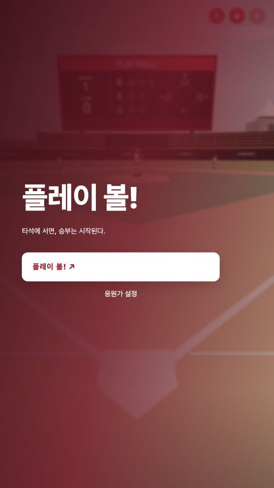
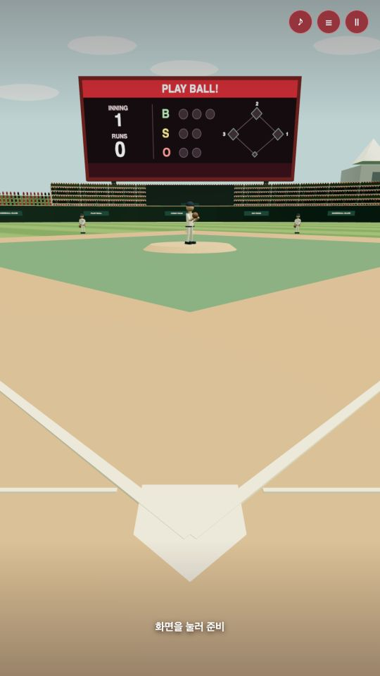

  

<h1 align="center">플레이 볼!</h1>

한 손으로 즐기는 1인칭 야구 게임

  <a href="https://legojeon.github.io/playball-web/">게임 하기</a> ·
  <a href="https://legojeon.github.io/playball-web/install.html">아이폰 설치 안내</a>

타석에서 공을 기다리고, 화면을 누른 채 조준한 뒤 손을 떼어 스윙합니다. 한 경기는 9회입니다. 아이폰·안드로이드·컴퓨터에서 웹으로 플레이할 수 있습니다.

## 게임 화면

  
  

## 조작 방법

1. **화면을 눌러 준비** — 잠시 후 투수가 공을 던집니다.
2. **누른 채 움직여 조준** — 손가락을 움직인 방향으로 배트가 움직입니다.
3. **손을 떼면 스윙** — 공이 배트에 닿을 순간 손을 떼세요.

컴퓨터에서는 마우스를 누른 채 움직이고 놓으면 됩니다. 진행 중인 경기는 자동 저장되며, 9회 완주 기록을 확인할 수 있습니다.

## 아이폰 홈 화면에 설치하기

1. [게임 메인 화면](https://legojeon.github.io/playball-web/)을 **Safari**에서 엽니다.
2. Safari의 **공유 → 홈 화면에 추가**를 누릅니다. ‘웹 앱으로 열기’가 표시되면 켜고 추가합니다.
3. 홈 화면의 **플레이 볼!** 아이콘으로 게임을 실행합니다.
4. 인터넷에 연결한 상태에서 게임을 시작하고 **설정(☰) → 오프라인 준비 완료**를 확인합니다.

설치 안내 페이지를 보고 있다면 맨 아래 **‘게임으로 돌아가기’** 버튼으로 게임 화면에 돌아온 뒤 공유 메뉴를 여세요. 초기 저장을 마치면 인터넷 없이도 플레이할 수 있습니다.

## 개인 응원가

응원가는 기본으로 포함되어 있지 않습니다. **응원가 설정**에서 기기의 오디오 파일을 타석 응원가와 테마 응원가로 추가할 수 있습니다. 음악 없이도 게임을 즐길 수 있습니다.

파일과 기록은 해당 기기에만 저장됩니다. 아이폰에서는 홈 화면에 설치한 앱 안에서 응원가를 추가하세요. Safari에서 저장한 데이터가 홈 화면 앱으로 옮겨지지 않을 수 있습니다. 데이터 삭제나 저장 공간 정리에 대비해 음원 원본은 따로 보관해 주세요.

## 업데이트와 문의

인터넷에 연결해 게임을 다시 열면 새 버전이 자동으로 적용됩니다. 경기 중에는 업데이트로 다시 시작하지 않습니다.

이 저장소에는 웹 배포 파일이 올라옵니다. 기본 효과음의 출처는 [크레딧](CREDITS.txt), Three.js의 라이선스는 [라이선스 문서](vendor/THREE-LICENSE.txt)에서 확인할 수 있습니다.

[개인정보처리방침](https://legojeon.github.io/playball-web/privacy.html) · [문의](mailto:jeus.kaist@gmail.com)
